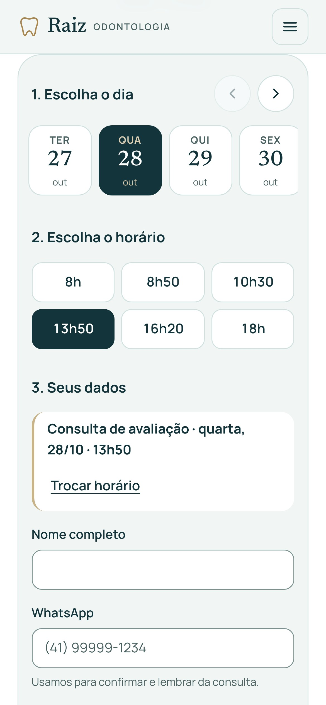

# Raiz Odontologia: landing page com agenda online


Landing page de clínica odontológica em que o paciente **vê os horários livres e marca a avaliação em 1 minuto**, direto no Google Agenda da clínica. Também tem agendamento pelo WhatsApp, formulário de contato para planilha e e-mail, SEO local e rastreamento pronto para Google Ads e Meta.

> **Projeto conceitual de portfólio** por João Pedro Morais. A clínica, a equipe e os contatos são fictícios.

**Site:** https://raizodontologia.vercel.app · **Estudo de caso:** [docs/estudo-de-caso.md](docs/estudo-de-caso.md)

## Funcionalidades

- **Agenda própria ligada ao Google Agenda:** mostra só horários livres (nunca dados de pacientes), confere de novo o horário antes de confirmar (dois cliques no mesmo horário: só um passa), cria o evento, registra na planilha e envia e-mail para a clínica e para o paciente. Gera arquivo `.ics` para a agenda do paciente.
- **WhatsApp como alternativa** visível em toda a página, com mensagem pronta para cada contexto.
- **Formulário de contato** com validação acessível, máscara de telefone, isca anti-robô, consentimento LGPD, UTMs e página de obrigado.
- **Rastreamento** (GA4, Google Ads, Meta Pixel, Clarity) carregado só depois do consentimento de cookies (Consent Mode v2).
- **SEO local:** dados estruturados `Dentist` (bairro, horários, equipe, tratamentos, área atendida), Open Graph, sitemap.
- **Painel de controle** (`js/config.js`) e textos marcados para edição pelo cliente.
- **Copy dentro das regras do CFO:** sem preço, sem promessa de resultado, sem depoimento inventado, responsável técnica e CRO visíveis.

| Agenda no computador | Agenda no celular |
|---|---|
|  |  |

## Qualidade

| Teste | Resultado |
|---|---|
| Lighthouse celular | Desempenho 96–99 · Acessibilidade 100 · Boas práticas 100 · SEO 100 |
| Lighthouse computador | 100 · 100 · 100 · 100 |
| Core Web Vitals (celular simulado) | LCP ~2,0 s · CLS 0 |
| axe (WCAG 2.2 AA) | 0 problemas |
| Validador do W3C | 0 erros |
| Responsividade | 320 a 1920px, celular deitado, tablet, texto em 200% |
| Teclado e leitor de tela | Tab completo sem armadilha, foco visível, anúncios na agenda |

Detalhes em [docs/revisao-2026-10-27.md](docs/revisao-2026-10-27.md).

## Tecnologias

HTML, CSS e JavaScript puros, sem frameworks, bibliotecas, npm ou etapa de build. Back-end em Google Apps Script (Agenda, Planilhas e Gmail). Hospedagem na Vercel.

## Estrutura

```
index.html · obrigado.html · politica-de-privacidade.html
css/      reset.css · variables.css (tokens) · style.css
js/       config.js (painel de controle) · utils.js · tracking.js · agenda.js · form.js · main.js · obrigado.js
assets/   img/ (WebP em 3 tamanhos, imagem de compartilhamento) · fonts/ (.woff2 + licenças OFL)
integracoes/apps-script/   Code.gs · appsscript.json · LEIA-ME.md
docs/     ponto de partida, briefing, persona, copy, identidade visual, SEO, revisão, estudo de caso, guia de edição, portfolio/
robots.txt · sitemap.xml · vercel.json
```

## Rodar localmente

Abra a pasta no VS Code e use a extensão **Live Server**, ou no terminal:

```
python -m http.server 8000
```

e acesse `http://localhost:8000`. Não abra o `index.html` direto pelo arquivo (`file://`).

## Configurar

Tudo o que muda fica em `js/config.js`:

- `modoDemo`: `true` mostra um aviso no lugar de WhatsApp e telefone fictícios.
- `agenda.appsScriptUrl` e `formulario.appsScriptUrl`: URL do App da Web (passo a passo em `integracoes/apps-script/LEIA-ME.md`). Vazio = horários simulados no navegador.
- `rastreamento`: IDs do GTM, GA4, Google Ads, Meta Pixel e Clarity. Sem ID, os eventos aparecem no console.
- Contatos, horários de atendimento, mensagens do WhatsApp e redes sociais.

Textos e imagens editáveis estão marcados no HTML com `<!-- ✏️ EDITÁVEL -->` … `<!-- ✏️ FIM -->`. Passo a passo para quem vai manter a página: [docs/guia-de-edicao.md](docs/guia-de-edicao.md).

## Eventos de conversão

| Evento | Quando | Meta |
|---|---|---|
| `agendamento_confirmado` | consulta marcada na agenda | Schedule |
| `generate_lead` | página de obrigado (uma vez por envio) | Lead |
| `clique_whatsapp` | qualquer botão de WhatsApp | Contact |
| `clique_telefone` | link de telefone | Contact |
| `agenda_vista` → `dia_escolhido` → `horario_escolhido` → `formulario_iniciado` | funil da agenda (sem dados pessoais) | — |
| `cta_clique`, `mapa_aberto` | botões de agendar e mapa do rodapé | — |

## Publicar

GitHub + Vercel, sem comando de build: cada commit sincronizado publica sozinho. Em outro endereço, atualize a URL em `index.html` (canonical, Open Graph e dados estruturados), `robots.txt` e `sitemap.xml`.

## Créditos

Fontes Newsreader e Manrope (SIL Open Font License). Fotos de banco de imagens licenciadas.
