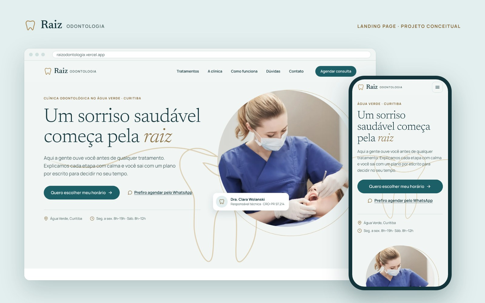
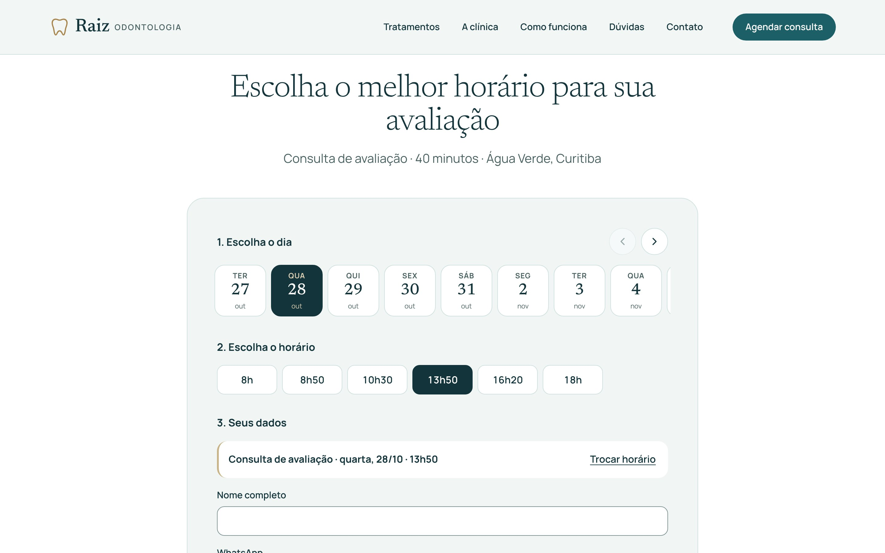

# Estudo de caso: Raiz Odontologia

**Landing page para clínica odontológica com agenda online**
Projeto conceitual de portfólio · João Pedro Morais · outubro de 2026
Site: https://raizodontologia.vercel.app · Código: https://github.com/joaoepedro/lp-raizodontologia

> A clínica, a equipe e os contatos são fictícios. O ponto de partida foi um pedido real de cliente: landing page para clínica odontológica, com foco em conversão, agendamento e regras do conselho de odontologia.

## O desafio

Clínicas odontológicas de bairro dependem de duas fontes de paciente: quem já procura dentista no Google e quem é impactado por anúncio no Instagram sem estar pensando nisso. A página precisava funcionar para os dois e levar a uma única ação: **marcar a primeira consulta de avaliação**.

Três restrições moldaram o trabalho:

1. **Regras do CFO.** O Código de Ética Odontológica proíbe anunciar preço, desconto ou "avaliação grátis", prometer resultado, usar superlativos e mostrar "antes e depois" sem autorização. Boa parte dos gatilhos comuns em landing pages fica de fora.
2. **Sem prova social inventada.** Num projeto conceitual, qualquer depoimento seria falso.
3. **Stack enxuta.** HTML, CSS e JavaScript puros, sem frameworks nem etapa de build, para o site ser rápido, barato de hospedar e fácil de manter.

## Pesquisa

- **Persona:** Camila, 37 anos, coordenadora de RH, mora no Água Verde. Está "desde antes da pandemia" sem ir ao dentista, tem a gengiva sangrando às vezes e quer levar o filho à primeira consulta. Resolve tudo pelo celular, no almoço ou à noite.
- **O que o público diz:** em reclamações públicas sobre clínicas, o medo de dor aparece menos que o medo de **ser enganado**: orçamento sem explicação, tratamento empurrado, falta de plano por escrito.
- **Concorrentes:** analisei 5 clínicas de Curitiba. **Nenhuma tinha agenda online com horários reais**: todas jogavam para o WhatsApp, onde a pessoa ainda precisa negociar horário. A maioria não mostrava o CRO, e várias usavam "grátis", "o melhor" ou "sem dor", termos que o CFO veta.

Daí veio o posicionamento: **marque online em 1 minuto, saia com um plano claro por escrito e decida com calma.** Seguir a norma virou sinal de seriedade.

## A solução

### Estratégia e copy

A ordem dos blocos segue a temperatura de cada público:

| Bloco | Para quem | O que faz |
|---|---|---|
| Hero | quem veio do Google (já procura dentista) | responde rápido: quem, onde, horário, "Quero escolher meu horário" |
| Cuidado antes da dor | quem veio do Instagram (ainda não sente necessidade) | mostra, sem alarmismo, por que vale uma avaliação agora |
| Tratamentos, A clínica, Equipe | os dois | autoridade com nomes, especialidades, CRO e estrutura concreta |
| O jeito Raiz, Como funciona | quem tem medo de ser enganado | plano por escrito, sem pressão, cada etapa explicada |
| Agenda | todos | a ação principal, com o WhatsApp como alternativa |
| Dúvidas e Contato | quem ainda hesita | preço, convênio, medo, "faz anos que não vou" |

No lugar dos depoimentos, a prova vem da **equipe nomeada, da estrutura concreta e da transparência**. Num projeto real, entraria um bloco com avaliações verdadeiras do Google.

### Identidade visual

- **Petróleo** (`#1D5F66`), que junta o azul de clínica e o verde de saúde num tom só, reservado ao botão de agendar.
- **Latão**, um dourado envelhecido, nos detalhes, para dar acolhimento sem soar luxuoso.
- **Newsreader Light** nos títulos e **Manrope** no texto.
- Elemento memorável: um **traço contínuo que vira um dente com raízes** atrás do hero ("um sorriso saudável começa pela raiz").

Todas as cores têm contraste calculado (mínimo 4,5:1 em texto).

### A agenda

O diferencial do projeto. O fluxo tem três passos na mesma tela: **dia → horário → dados**. Nos bastidores, a agenda oficial da clínica continua sendo o Google Agenda, para não haver uma agenda paralela:

- O **Google Apps Script** devolve só os horários livres, calculados a partir do expediente, da pausa do almoço, da antecedência mínima e dos eventos já existentes, inclusive os criados à mão pela recepção. **Nenhum dado de paciente sai do servidor.**
- Ao confirmar, o script **trava** a agenda (`LockService`), confere o horário de novo e só então cria o evento. Se duas pessoas confirmam o mesmo horário juntas, só uma passa; a outra recebe um aviso, a lista se atualiza e os dados digitados continuam no formulário.
- O agendamento vai para a planilha (com UTMs, página de entrada e dispositivo) e dispara e-mail para a clínica e para o paciente.
- Proteções: isca anti-robô, limite por WhatsApp e por hora, valores da planilha protegidos contra fórmulas.

### Medição e privacidade

- Funil anônimo no GA4: `agenda_vista` → `dia_escolhido` → `horario_escolhido` → `formulario_iniciado` → `agendamento_confirmado`. Nenhum dado pessoal vai para as ferramentas de medição, e quem abandona não deixa rastro.
- Conversões para Google Ads e Meta (`Schedule`, `Lead`, `Contact`) com o mesmo ID de evento, prontas para a API de Conversões.
- Banner de cookies com Consent Mode v2: Meta Pixel e Clarity só carregam depois do aceite.

## Técnica

- **Painel de controle:** contatos, horários da agenda, mensagens do WhatsApp e IDs de rastreamento num único arquivo (`config.js`), congelado para nenhum script alterar.
- **Edição pelo cliente:** textos marcados no HTML para editar pelo próprio GitHub, com publicação automática na Vercel.
- **Recursos nativos do navegador** no lugar de bibliotecas: `
` nas dúvidas, `<dialog>` nas janelas, `IntersectionObserver` nas animações, validação própria, `scroll-snap` na faixa de dias.
- **Desempenho:** imagens WebP em 3 tamanhos, fontes servidas pelo próprio site com pré-carregamento, scripts com `defer`, mapa carregado só sob clique.
- **Acessibilidade:** a agenda funciona inteira pelo teclado, com estado "selecionado" e anúncios para leitor de tela; o erro do formulário só some quando a pessoa digita (não ao sair do campo, para o layout não pular); animações respeitam o "movimento reduzido" do sistema.
- **SEO local:** dados estruturados `Dentist` com bairro, horários, área atendida, tratamentos e equipe.

## Resultados

| Teste | Resultado |
|---|---|
| Lighthouse celular | Desempenho 96–99 · Acessibilidade 100 · Boas práticas 100 · SEO 100 |
| Lighthouse computador | 100 em tudo |
| Core Web Vitals | LCP ~2,0 s no celular simulado · CLS 0 |
| axe (WCAG 2.2 AA) e W3C | 0 problemas |
| Agenda real (Google Agenda) | Testada no computador e no celular: evento criado, horário some da página, evento manual bloqueia o horário, conflito simultâneo barrado |

Por ser um projeto conceitual, não há números de conversão. Num cliente real, o acompanhamento começaria com o funil da agenda: em que passo as pessoas desistem, de onde vêm os agendamentos (UTMs na planilha) e quanto custa cada consulta marcada.

## Aprendizados

- **Restrição vira diferencial.** Sem preço, sem "grátis" e sem depoimento, a página teve de convencer com clareza e transparência, e isso conversou melhor com o medo real da persona (ser enganada) do que os gatilhos de sempre.
- **O diferencial apareceu na pesquisa, não no layout.** Ver que nenhum concorrente tinha agenda online definiu o projeto inteiro.
- **Testar como as pessoas usam de verdade.** A revisão encontrou problemas que nenhuma ferramenta automática apontava:
  - um evento de dois dias que só bloqueava o primeiro;
  - o desenho do dente cortado em telas largas;
  - texto escapando da tela para quem usa fonte grande no celular.
- **Agenda única.** Ligar a página ao Google Agenda que a clínica já usa, em vez de criar outra, evita horário duplicado e retrabalho na recepção.
- **Dado fictício também exige cuidado.** Antes de deixar a página aparecer no Google, conferi nomes e números de registro para não coincidirem com profissionais reais.
